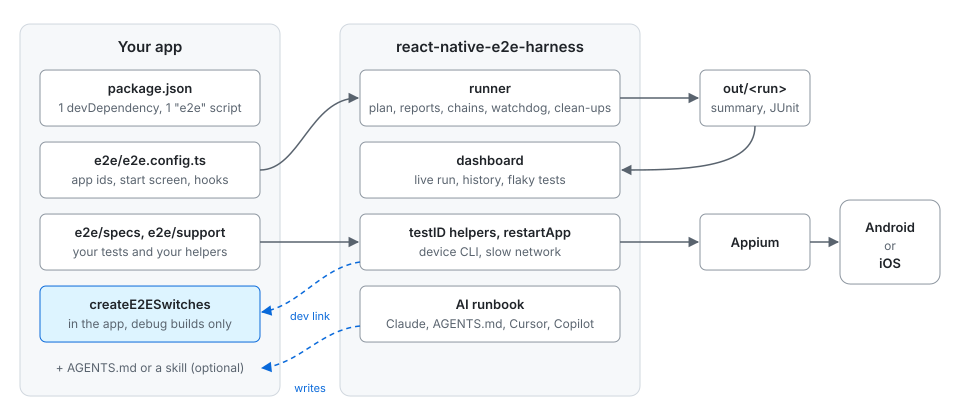

# react-native-e2e-harness

End-to-end tests for React Native apps, written against the app's own `testID`s. Appium and WebdriverIO do the driving; the harness adds what a team needs around them: helpers that read like the app, fast restarts, a device CLI for one-off checks, a run dashboard with history and flaky tests, chained tests, a watchdog for a frozen app, and a runbook for your AI assistant.

<p align="center"></p>

## Quick start

1. **Install** it as a dev dependency (it brings WebdriverIO and Mocha with it), and Appium once per machine:

   ```sh
   yarn add -D react-native-e2e-harness
   npm install -g appium && appium driver install uiautomator2   # iOS too: appium driver install xcuitest
   ```

   (or `npm install -D`, `pnpm add -D`, `bun add -d`)

2. **Set it up** in the app's root. `init` reads your app ids from the native projects (or Expo's `app.json`), creates the `e2e/` folder and adds one script:

   ```sh
   npx e2e-harness init
   ```

3. **Point it at your start screen:** in `e2e/e2e.config.ts`, set `home.ready` to a testID that is only there once your first screen is ready.

4. **Run** on an emulator or a connected phone, with a debug build of the app installed:

   ```sh
   yarn e2e preflight   # the device, the app, Appium and Metro ready, or why not
   yarn e2e run         # the specs; the summary is in e2e/out/<run>/summary.md
   ```

5. **Optional:** fast restarts (a JS reload instead of a cold start) with the [in-app switches](packages/harness/README.md#in-the-app), and the runbook for your AI assistant: `yarn e2e ai --tool claude|agents|cursor|copilot`.

## What it adds to your project

```
your-app/
├── package.json        + 1 devDependency, 1 script ("e2e"), 1 field ("e2e-harness")
├── App.tsx             + optional: createE2ESwitches(...), debug builds only
└── e2e/                new; commit it
    ├── package.json    { "type": "module" }: the folder is ES modules, whatever the app is
    ├── e2e.config.ts   app ids, start screen, hooks into your support code
    ├── wdio.conf.ts    one line
    ├── tsconfig.json   its own: Mocha's types, kept apart from the app's Jest
    ├── .env.e2e.example    the settings and secrets a run needs (committed)
    ├── .env.e2e        your values (git-ignored)
    ├── specs/          your tests: *.e2e.ts
    ├── support/        your helpers: sign-in, your backend, clean-ups, screen helpers
    └── out/            written by runs (git-ignored): summary.md, JUnit XML,
                        screenshots and UI trees of failures, logs
```

Nothing native, nothing in a release bundle (the in-app module only loads under `__DEV__`), nothing installed on the device but your app. Appium is installed globally by you. `slow-net` sets the device's proxy only while it runs.

**See it working:** [`example/`](example) is a small React Native app tested this way, its specs green on an Android emulator in CI for every change: [`example/e2e/`](example/e2e) is a complete e2e folder to copy from.

## What's in it

| Layer        | What it gives you                                                                                                                                                                                                                                                                                              |
| ------------ | -------------------------------------------------------------------------------------------------------------------------------------------------------------------------------------------------------------------------------------------------------------------------------------------------------------- |
| core         | Runs described as a plan, an event stream per run, Markdown and JSON reports, chained tests that reuse state instead of restarting the app, a "needs a person first" result for steps a machine cannot do, a watchdog that kills and reports a frozen app                                                      |
| react-native | `tap`, `waitFor`, `scrollTo`, `tapUntil` and friends by `testID`, fresh install and cold restart, keyboard and system-alert handling, Android device and emulator control, physical iPhone support, Metro checks, a slow or failing network on chosen hosts, a CLI for single commands against the running app |
| dashboard    | A local web page over the run folders: overview, start runs, run history, a page per run, flaky tests, a module-by-device matrix                                                                                                                                                                               |
| AI runbook   | The e2e runbook for Claude Code (skill or plugin), `AGENTS.md` (Codex, Cursor, Copilot, Gemini CLI…), Cursor rules and Copilot instructions, from one source: `e2e-harness ai --tool …`                                                                                                                        |

Everything about using it (the config, the helpers, the dashboard, the CLI, what it works with): **[packages/harness/README.md](packages/harness/README.md)**.

## Requirements

- React Native 0.76 or later, new architecture (tested on 0.84); the in-app module needs React 18 or later
- Node 20.12 or later
- Appium with the UiAutomator2 (Android) and XCUITest (iOS) drivers
- An app whose interactive elements carry `testID`s
- iOS: a Mac with Xcode

> **Status:** on npm as [`react-native-e2e-harness`](https://www.npmjs.com/package/react-native-e2e-harness), extracted from the test suite of a production React Native app. Progress is tracked in the [issues](../../issues).

## Contributing

See [CONTRIBUTING.md](CONTRIBUTING.md) and the [code of conduct](CODE_OF_CONDUCT.md).

## License

[MIT](LICENSE)
