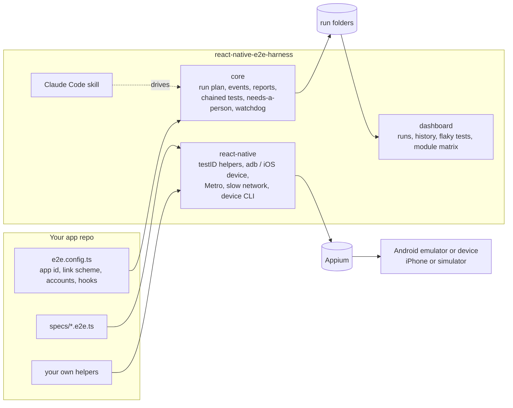

# react-native-e2e-harness

End-to-end tests for React Native apps, written against the app's own `testID`s. Appium and WebdriverIO do the driving. This package adds what a team needs around them: helpers that read like the app, a device CLI for one-off checks, a run dashboard with history and flaky-test tracking, chained tests, a watchdog for a frozen app, and a Claude Code skill that runs it all.

> **Status:** being extracted from the test suite of a production React Native app. Nothing is published yet. Progress is tracked in the [issues](../../issues).

## How it fits together

## What's in it

| Layer        | What it gives you                                                                                                                                                                                                                                                                                              |
| ------------ | -------------------------------------------------------------------------------------------------------------------------------------------------------------------------------------------------------------------------------------------------------------------------------------------------------------- |
| core         | Runs described as a plan, an event stream per run, Markdown and JSON reports, chained tests that reuse state instead of restarting the app, a "needs a person first" result for steps a machine cannot do, a watchdog that kills and reports a frozen app                                                      |
| react-native | `tap`, `waitFor`, `scrollTo`, `tapUntil` and friends by `testID`, fresh install and cold restart, keyboard and system-alert handling, Android device and emulator control, physical iPhone support, Metro checks, a slow or failing network on chosen hosts, a CLI for single commands against the running app |
| dashboard    | A local web page over the run folders: overview, start runs, run history, a page per run, flaky tests, a module-by-device matrix                                                                                                                                                                               |
| skill        | A Claude Code plugin with an `e2e` skill: preflight, run one spec or the suite, read the summary, write a spec after a feature or before a bug fix                                                                                                                                                             |

## Requirements

- Node 22 or later
- Appium with the UiAutomator2 (Android) and XCUITest (iOS) drivers
- An app whose interactive elements carry `testID`s

## Contributing

See [CONTRIBUTING.md](CONTRIBUTING.md).

## License

[MIT](LICENSE)
