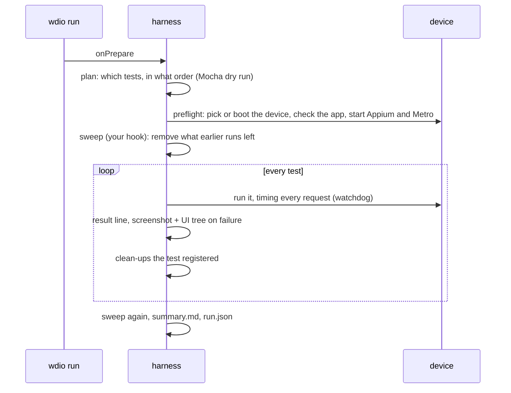

# react-native-e2e-harness

End-to-end tests for React Native apps on Appium and WebdriverIO, with the runner around them: a preflight that gets the device ready or says why it can't, one summary per run, chained tests, a watchdog for a frozen app, clean-up of what tests write, and reports that prune themselves.

> Early days: the core runner is here; the testID helpers, the device CLI and the dashboard are on their way ([roadmap](https://github.com/hdjvieira/react-native-e2e-harness/issues/9)).

## Install

While the repo is private, from git:

```sh
yarn add -D "react-native-e2e-harness@github:hdjvieira/react-native-e2e-harness#workspace=react-native-e2e-harness" \
  webdriverio @wdio/cli @wdio/local-runner @wdio/mocha-framework @wdio/spec-reporter @wdio/globals mocha @types/mocha
```

You also need Appium with the drivers for your platforms (`appium driver install uiautomator2`, `appium driver install xcuitest`). The harness starts Appium itself when it isn't running.

## Set up

An `e2e/` folder in the app with three files:

```ts
// e2e/e2e.config.ts
import { defineConfig } from 'react-native-e2e-harness'

export default defineConfig({
  dir: import.meta.dirname,
  android: {
    package: 'com.example.app',
    permissions: ['android.permission.POST_NOTIFICATIONS'],
  },
  ios: { bundleId: 'com.example.app', executable: 'Example' },
  mainRef: 'origin/main',
})
```

```ts
// e2e/wdio.conf.ts
import { createWdioConfig } from 'react-native-e2e-harness'
import harness from './e2e.config.ts'

export const config = createWdioConfig(harness)
```

```ts
// e2e/specs/sign-in.e2e.ts
import { $ } from '@wdio/globals'

describe('Sign in', () => {
  it('shows the form', async () => {
    await $('~login-form').waitForExist()
  })
})
```

Run it with `wdio run wdio.conf.ts` from `e2e/`.

## What a run does



Everything a run writes goes to `out/<run>/`: `summary.md` to read, plus `run.json`, `results.jsonl`, `events.jsonl`, `timing.jsonl` and the failure artifacts.

## In a spec

| Helper                       | What for                                                                                                                                                                                                 |
| ---------------------------- | -------------------------------------------------------------------------------------------------------------------------------------------------------------------------------------------------------- |
| `chain()`                    | Tests that carry on from the screen the previous one left, instead of starting over. Each names where it begins (`check`) and how to get there (`arrive`); a failure costs one rebuild, never a cascade. |
| `needsPerson(this, what)`    | A test that can't go on until someone does something by hand on the device. It ends neither passed nor failed, and the summary lists what to do.                                                         |
| `registerCleanup(label, fn)` | Undo a write on a shared backend after the test, passed or not. Register it before the write.                                                                                                            |
| `measure(label, fn)`         | Time a slow step; the summary totals every label.                                                                                                                                                        |
| `envValue(key)`              | A secret or setting from `.env.e2e`.                                                                                                                                                                     |

Tags are `#words` in test titles. `#android`, `#ios`, `#on-android-emulator-only`, `#on-android-device-only`, `#on-ios-simulator-only` and `#on-ios-device-only` decide where a test runs; any other tag can be grepped for.

## Settings and secrets

`.env.e2e` (git-ignored) holds them; `.env.e2e.example` (committed) lists every key with a comment on what it is, under `# [required]` or `# [optional]`. The preflight stops a run when a required key is missing.

The device comes from the environment:

| Variable             | Meaning                                                               |
| -------------------- | --------------------------------------------------------------------- |
| `E2E_PLATFORM`       | `android` (default when configured) or `ios`                          |
| `E2E_ANDROID_DEVICE` | adb serial; empty means an emulator, booted if none runs              |
| `E2E_AVD`            | the AVD to boot                                                       |
| `E2E_IOS_UDID`       | a physical iPhone; empty means one on a cable, if any                 |
| `E2E_SIMULATOR`      | an iOS simulator's name or UDID                                       |
| `E2E_IOS_TEAM`       | Apple team that signs WebDriverAgent on a phone (or `ios.teamId`)     |
| `E2E_WINDOWS=off`    | start Appium and Metro detached instead of in a terminal window       |
| `E2E_CHAIN_STOP=1`   | the first failure in a chain stops it and leaves the screen as it was |

## CLI

Run from the e2e folder:

```sh
npx e2e-harness preflight          # get the device ready, or say why not
npx e2e-harness tests              # every device test and its tags
npx e2e-harness reports [--prune]  # each run's release and results, and which can go
npx e2e-harness sweep              # run your sweep hook
```
