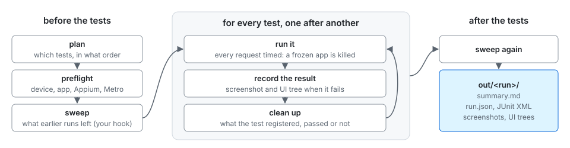
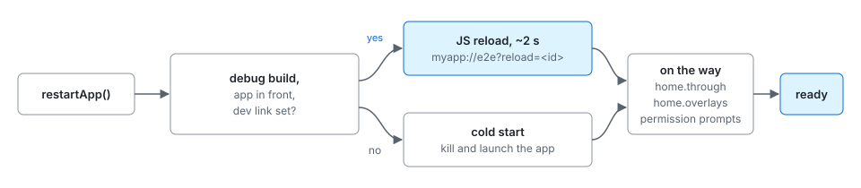
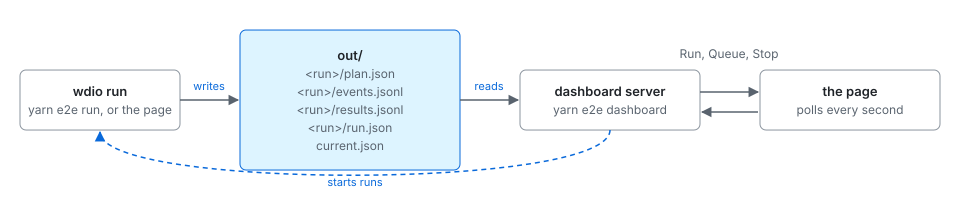

# react-native-e2e-harness

End-to-end tests for React Native apps on Appium and WebdriverIO, with the runner around them: a preflight that gets the device ready or says why it can't, one summary per run, chained tests, a watchdog for a frozen app, clean-up of what tests write, and reports that prune themselves.

> Not on npm yet: install it from GitHub (below). An example app runs its specs with it on an Android emulator in CI ([roadmap](https://github.com/hdjvieira/react-native-e2e-harness/issues/9)).

## Quick start

1. **Install** it as a dev dependency (it brings WebdriverIO and Mocha with it), and Appium once per machine:

   ```sh
   yarn add -D "react-native-e2e-harness@github:hdjvieira/react-native-e2e-harness#workspace=react-native-e2e-harness"
   npm install -g appium && appium driver install uiautomator2   # iOS too: appium driver install xcuitest
   ```

   (npm, pnpm and bun work the same. Until the first release, the package comes from this repo.)

2. **Set it up** in the app's root. `init` reads your app ids from the native projects (or Expo's `app.json`), creates the `e2e/` folder and adds one script:

   ```sh
   npx e2e-harness init
   ```

3. **Point it at your start screen:** in `e2e/e2e.config.ts`, set `home.ready` to a testID that is only there once your first screen is ready.

4. **Run** on an emulator or a connected phone, with a debug build of the app installed:

   ```sh
   yarn e2e preflight   # the device, the app, Appium and Metro ready, or why not
   yarn e2e run         # the specs; the summary is in e2e/out/<run>/summary.md
   ```

5. **Optional:** fast restarts (a JS reload instead of a cold start) with the [in-app switches](#in-the-app), and the runbook for your AI assistant: `yarn e2e ai --tool claude|agents|cursor|copilot`.

## What it adds to your project

```
your-app/
├── package.json        + 1 devDependency, 1 script ("e2e"), 1 field ("e2e-harness")
├── App.tsx             + optional: createE2ESwitches(...), debug builds only
└── e2e/                new; commit it
    ├── e2e.config.ts   app ids, start screen, hooks into your support code
    ├── wdio.conf.ts    one line
    ├── tsconfig.json   its own: Mocha's types, kept apart from the app's Jest
    ├── .env.e2e.example    the settings and secrets a run needs (committed)
    ├── .env.e2e        your values (git-ignored)
    ├── specs/          your tests: *.e2e.ts
    ├── support/        your helpers: sign-in, your backend, clean-ups, screen helpers
    └── out/            written by runs (git-ignored): summary.md, JUnit XML,
                        screenshots and UI trees of failures, logs
```

Nothing native, nothing in a release bundle (the in-app module only loads under `__DEV__`), nothing installed on the device but your app. Appium is installed globally by you. `slow-net` sets the device's proxy only while it runs.

**See it working:** [`example/`](https://github.com/hdjvieira/react-native-e2e-harness/tree/main/example) is a small React Native app tested this way, its specs green on an Android emulator in CI for every change: [`example/e2e/`](https://github.com/hdjvieira/react-native-e2e-harness/tree/main/example/e2e) is a complete e2e folder to copy from.

## Set up by hand

What `init` writes, if you would rather write it yourself:

An `e2e/` folder in the app with three files:

```ts
// e2e/e2e.config.ts
import { defineConfig } from 'react-native-e2e-harness'

export default defineConfig({
  dir: import.meta.dirname,
  android: {
    package: 'com.example.app',
    permissions: ['android.permission.POST_NOTIFICATIONS'],
  },
  ios: { bundleId: 'com.example.app', executable: 'Example' },
  mainRef: 'origin/main',
  // the screen every test starts from, and what to get through on the way
  home: {
    ready: 'home-screen',
    through: ['onboarding-next-button', 'onboarding-done-button'],
    overlays: ['promo-close-button'],
  },
  // the app's dev-only link (see "In the app" below)
  devLink: { url: 'myapp://e2e' },
})
```

```ts
// e2e/wdio.conf.ts
import { createWdioConfig } from 'react-native-e2e-harness'
import harness from './e2e.config.ts'

export const config = createWdioConfig(harness)
```

```ts
// e2e/specs/sign-in.e2e.ts
import { restartApp, tap, waitFor } from 'react-native-e2e-harness'

describe('Sign in', () => {
  beforeEach(() => restartApp())

  it('opens the form', async () => {
    await tap('home-sign-in-button')
    await waitFor('login-form')
  })
})
```

Run it with `yarn e2e run`.

## What a run does



Everything a run writes goes to `out/<run>/`: `summary.md` to read, plus `run.json`, `results.jsonl`, `events.jsonl`, `timing.jsonl` and the failure artifacts.

## In the app

A restart is fastest as a JS reload: the native app keeps running and the JS starts over, rehydrated from storage like a cold start, in a fraction of the time. The app answers a dev-only link for that, in debug builds only:

```ts
// at start-up, e.g. index.js
import AsyncStorage from '@react-native-async-storage/async-storage'

if (__DEV__) {
  const { createE2ESwitches } = require('react-native-e2e-harness/in-app')
  createE2ESwitches({
    url: 'myapp://e2e',
    storage: AsyncStorage,
    // your own: flags the app reads, actions it runs
    flags: { showDebugReadout: { default: false, keepOnReload: true } },
    actions: { openOrder: id => navigation.navigate('Order', { id }) },
  })
}
```



Built-in switches: `reload=<id>` (once-only), `logbox=off` (LogBox toasts take taps a test can't see), `keyboard=dismiss` (iOS has no reliable way otherwise). Your flags are set with `name=on|off|<value>` and read with the returned `flags`, `useFlag(name)` or `onChange()`; your actions run with the parameter's value. Without a dev link, every restart is a cold start.

## In a spec

The UI by testID, the same on both platforms:

| Helper                                                    | What for                                                                                                                                         |
| --------------------------------------------------------- | ------------------------------------------------------------------------------------------------------------------------------------------------ |
| `restartApp({ cold })`                                    | Back to `home`, fresh: reload or cold start                                                                                                      |
| `tap(id, { settle })`, `tapUntil(id, opens)`              | Tap; tap again until something opens (iOS drops taps during transitions)                                                                         |
| `waitFor`, `waitGone`, `waitForAny`, `exists`             | Wait for testIDs                                                                                                                                 |
| `text`, `label`, `onScreen`                               | Read what is shown                                                                                                                               |
| `scrollTo(id, page, { below, slow })`, `swipe`, `drag`    | Scroll until the element is clear of the edges (a sticky header or a sheet's tabs: `below`; inside a sheet: `slow`, held drags that don't fling) |
| `collectIds(endId)`                                       | Every testID down a long page in one pass, instead of a scrollTo per row                                                                         |
| `byLabel`, `byText`, `tapLabel`, `tapText`, `waitForText` | For what has no testID (a third-party component, a system screen): by accessibility label or by the text shown                                   |
| `$`, `$$`, `driver`, `expect`                             | WebdriverIO's own, re-exported: a spec imports from this package alone                                                                           |
| `allMatching(regex)`, `matchingWithText`, `rowContaining` | Rows by testID pattern and text                                                                                                                  |
| `openLink(link)`, `deepLink(url)`                         | Send a link, a path on `webBase` or a full URL                                                                                                   |
| `hideKeyboard`, `acceptIosAlert`, `closeShareSheet`       | System UI                                                                                                                                        |
| `freshInstall(id)`                                        | Android: wipe the app's data and open it                                                                                                         |
| `markFresh()`                                             | Your sign-in helper left the app fresh: skip the next restart                                                                                    |

And around the tests:

| Helper                       | What for                                                                                                                                                                                                 |
| ---------------------------- | -------------------------------------------------------------------------------------------------------------------------------------------------------------------------------------------------------- |
| `chain()`                    | Tests that carry on from the screen the previous one left, instead of starting over. Each names where it begins (`check`) and how to get there (`arrive`); a failure costs one rebuild, never a cascade. |
| `needsPerson(this, what)`    | A test that can't go on until someone does something by hand on the device. It ends neither passed nor failed, and the summary lists what to do.                                                         |
| `registerCleanup(label, fn)` | Undo a write on a shared backend after the test, passed or not. Register it before the write.                                                                                                            |
| `measure(label, fn)`         | Time a slow step; the summary totals every label.                                                                                                                                                        |
| `envValue(key)`              | A secret or setting from `.env.e2e`.                                                                                                                                                                     |

Tags are `#words` in test titles. `#android`, `#ios`, `#on-android-emulator-only`, `#on-android-device-only`, `#on-ios-simulator-only` and `#on-ios-device-only` decide where a test runs; any other tag can be grepped for.

## Dashboard

A local web page over the run folders: the run going on (with an ETA from past runs), every past run with its failures, screenshots and UI trees, flaky tests, and a module-by-device matrix. It also starts runs: pick tests and a device, queue the next run while one goes on, rerun what failed.



A run opens it by itself: it starts the server in a window of its own when none answers, and opens the page on the run unless one is already open (`E2E_UI=off` leaves it out, and so does CI). Or start it with `yarn e2e dashboard`. It listens on port 4777 (`dashboard.port` in the config, or `E2E_DASHBOARD_PORT`); `dashboard.title` names it, and `dashboard.tags` says what your own tags mean (`{ '#slow': 'Takes minutes' }`), shown when the mouse is on a tag.

## With an AI assistant

The e2e runbook (consent rules: never drive a device unasked, never wipe a phone's data without an OK; preflight, running and reporting, writing specs, ad-hoc device checks, the traps) comes for the main coding assistants, from one source:

```sh
yarn e2e ai --tool claude     # .claude/skills/e2e/SKILL.md, a Claude Code skill
yarn e2e ai --tool agents     # a section of AGENTS.md: Codex, Cursor, Copilot's agent, Gemini CLI and others
yarn e2e ai --tool cursor     # .cursor/rules/e2e.mdc
yarn e2e ai --tool copilot    # .github/instructions/e2e.instructions.md
```

Run it again after updating the harness: it replaces what it wrote before, and in `AGENTS.md` only its own section. Claude Code users can also install it as a plugin, which updates itself:

```
/plugin marketplace add hdjvieira/react-native-e2e-harness
/plugin install react-native-e2e-harness@react-native-e2e-harness
```

## Works with

|                  |                                                                                                                                                                                                                |
| ---------------- | -------------------------------------------------------------------------------------------------------------------------------------------------------------------------------------------------------------- |
| React Native     | the CLI's apps and **Expo** with a development build (`expo` in the app's package.json makes Metro start with `npx expo start --dev-client`; Expo Go can't be tested: its app id isn't yours)                  |
| Package managers | Yarn (node_modules linker), npm, pnpm, bun: specs import everything from `react-native-e2e-harness`, so a strict `node_modules` is fine. Yarn Plug'n'Play is not supported: WebdriverIO needs a `node_modules` |
| Build variants   | an app id per variant (`android: { package: { debug: 'com.app.debug', release: 'com.app' }, namespace: 'com.app' }`), picked by `E2E_VARIANT` (default `debug`); the same for `ios.bundleId`                   |
| CI               | every run also writes JUnit XML (`out/<run>/junit-*.xml`) for the CI's test view; `reports: { junit: false, reporters: [...] }` turns it off or adds WebdriverIO reporters                                     |
| Hosts            | Windows, macOS (iOS needs it), Linux                                                                                                                                                                           |
| Builds           | debug (fast restarts through the dev link, Metro) and release (cold starts, no Metro)                                                                                                                          |

## Settings and secrets

`.env.e2e` (git-ignored) holds them; `.env.e2e.example` (committed) lists every key with a comment on what it is, under `# [required]` or `# [optional]`. The preflight stops a run when a required key is missing.

The device comes from the environment:

| Variable             | Meaning                                                               |
| -------------------- | --------------------------------------------------------------------- |
| `E2E_PLATFORM`       | `android` (default when configured) or `ios`                          |
| `E2E_ANDROID_DEVICE` | adb serial; empty means an emulator, booted if none runs              |
| `E2E_AVD`            | the AVD to boot                                                       |
| `E2E_IOS_UDID`       | a physical iPhone; empty means one on a cable, if any                 |
| `E2E_SIMULATOR`      | an iOS simulator's name or UDID                                       |
| `E2E_IOS_TEAM`       | Apple team that signs WebDriverAgent on a phone (or `ios.teamId`)     |
| `E2E_WINDOWS=off`    | start Appium and Metro detached instead of in a terminal window       |
| `E2E_CHAIN_STOP=1`   | the first failure in a chain stops it and leaves the screen as it was |

## CLI

From anywhere in the app, through its `e2e` script (or `npx e2e-harness`):

```sh
yarn e2e run                                   # every spec
yarn e2e run --spec specs/login.e2e.ts         # one spec (repeat --spec for more)
yarn e2e run --grep "#slow" --invert           # leave a tag out (quoted: # starts a shell comment)
yarn e2e api                                   # the specs that need no device (config api.specs)
```

Any other option goes to WebdriverIO as it is. The config is found from the current folder, then the app's `package.json` field, then `e2e/` or `__e2eTests__/` beside it; `--config <path>` overrides.

Run from the e2e folder:

```sh
yarn e2e preflight          # get the device ready, or say why not
yarn e2e tests              # every device test and its tags
yarn e2e reports [--prune]  # each run's release and results, and which can go
yarn e2e sweep              # run your sweep hook
yarn e2e dashboard          # the run dashboard, until its window closes
```

### One command at a time

For a quick check on a device that isn't a spec (yet), by testID rather than by screenshot. Each command is a process of its own; the Appium session is cached between them.

```sh
yarn e2e device preflight            # device, build, which Metro, port reverse
yarn e2e device ids                  # testIDs on screen
yarn e2e device tap login-button --watch 5000 login-spinner
yarn e2e device wait home-screen 20000
yarn e2e device text order-total
yarn e2e device jslog 40 error       # the app's JS log
yarn e2e ios-device start            # an iPhone on a cable
yarn e2e ios-device tap login-button
```

`device help` and `ios-device help` list every command. Android uses Appium when it runs and falls back to adb; it dismisses React Native's LogBox toasts before each command, so a tap never lands on one.

### A slow network

```sh
yarn e2e slow-net --hosts 'api\.example\.com' --delay 8000 --for 120000
yarn e2e slow-net --hosts 'config' --fail
yarn e2e slow-net --restore          # after a crash left the proxy set
```

A small HTTPS proxy on your machine, reached through `adb reverse`, holds (or refuses) connections to matching hosts; everything else, Metro included, passes through. It sets the device's global proxy while it runs and puts it back when it stops.
