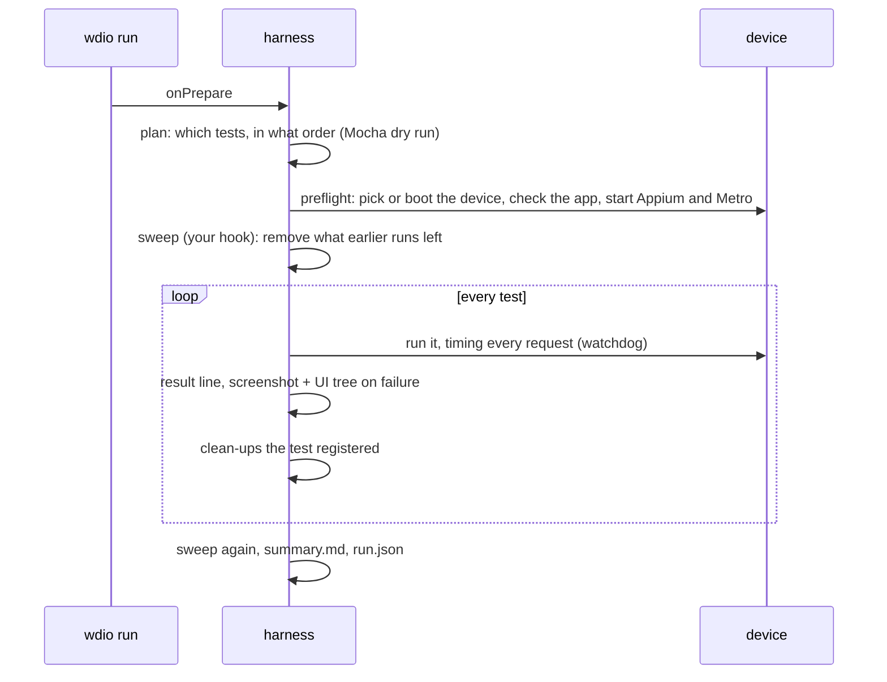
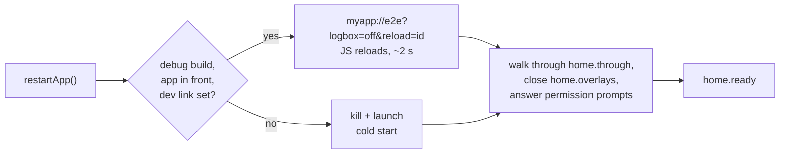
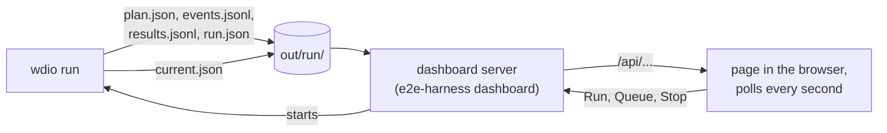

# react-native-e2e-harness

End-to-end tests for React Native apps on Appium and WebdriverIO, with the runner around them: a preflight that gets the device ready or says why it can't, one summary per run, chained tests, a watchdog for a frozen app, clean-up of what tests write, and reports that prune themselves.

> Early days: every layer is here and unit-tested; it has not yet run against an app on a device from this package ([roadmap](https://github.com/hdjvieira/react-native-e2e-harness/issues/9)).

## Install

While the repo is private, from git:

```sh
yarn add -D "react-native-e2e-harness@github:hdjvieira/react-native-e2e-harness#workspace=react-native-e2e-harness" \
  webdriverio @wdio/cli @wdio/local-runner @wdio/mocha-framework @wdio/spec-reporter @wdio/globals mocha @types/mocha
```

You also need Appium with the drivers for your platforms (`appium driver install uiautomator2`, `appium driver install xcuitest`). The harness starts Appium itself when it isn't running.

## Set up

An `e2e/` folder in the app with three files:

```ts
// e2e/e2e.config.ts
import { defineConfig } from 'react-native-e2e-harness'

export default defineConfig({
  dir: import.meta.dirname,
  android: {
    package: 'com.example.app',
    permissions: ['android.permission.POST_NOTIFICATIONS'],
  },
  ios: { bundleId: 'com.example.app', executable: 'Example' },
  mainRef: 'origin/main',
  // the screen every test starts from, and what to get through on the way
  home: {
    ready: 'home-screen',
    through: ['onboarding-next-button', 'onboarding-done-button'],
    overlays: ['promo-close-button'],
  },
  // the app's dev-only link (see "In the app" below)
  devLink: { url: 'myapp://e2e' },
})
```

```ts
// e2e/wdio.conf.ts
import { createWdioConfig } from 'react-native-e2e-harness'
import harness from './e2e.config.ts'

export const config = createWdioConfig(harness)
```

```ts
// e2e/specs/sign-in.e2e.ts
import { restartApp, tap, waitFor } from 'react-native-e2e-harness'

describe('Sign in', () => {
  beforeEach(() => restartApp())

  it('opens the form', async () => {
    await tap('home-sign-in-button')
    await waitFor('login-form')
  })
})
```

Run it with `wdio run wdio.conf.ts` from `e2e/`.

## What a run does



Everything a run writes goes to `out/<run>/`: `summary.md` to read, plus `run.json`, `results.jsonl`, `events.jsonl`, `timing.jsonl` and the failure artifacts.

## In the app

A restart is fastest as a JS reload: the native app keeps running and the JS starts over, rehydrated from storage like a cold start, in a fraction of the time. The app answers a dev-only link for that, in debug builds only:

```ts
// at start-up, e.g. index.js
import AsyncStorage from '@react-native-async-storage/async-storage'

if (__DEV__) {
  const { createE2ESwitches } = require('react-native-e2e-harness/in-app')
  createE2ESwitches({
    url: 'myapp://e2e',
    storage: AsyncStorage,
    // your own: flags the app reads, actions it runs
    flags: { showDebugReadout: { default: false, keepOnReload: true } },
    actions: { openOrder: id => navigation.navigate('Order', { id }) },
  })
}
```



Built-in switches: `reload=<id>` (once-only), `logbox=off` (LogBox toasts take taps a test can't see), `keyboard=dismiss` (iOS has no reliable way otherwise). Your flags are set with `name=on|off|<value>` and read with the returned `flags`, `useFlag(name)` or `onChange()`; your actions run with the parameter's value. Without a dev link, every restart is a cold start.

## In a spec

The UI by testID, the same on both platforms:

| Helper                                                    | What for                                                                 |
| --------------------------------------------------------- | ------------------------------------------------------------------------ |
| `restartApp({ cold })`                                    | Back to `home`, fresh: reload or cold start                              |
| `tap(id, { settle })`, `tapUntil(id, opens)`              | Tap; tap again until something opens (iOS drops taps during transitions) |
| `waitFor`, `waitGone`, `waitForAny`, `exists`             | Wait for testIDs                                                         |
| `text`, `label`, `onScreen`                               | Read what is shown                                                       |
| `scrollTo(id, page)`, `swipe`                             | Scroll a page until the element is clear of its edges                    |
| `allMatching(regex)`, `matchingWithText`, `rowContaining` | Rows by testID pattern and text                                          |
| `openLink(link)`, `deepLink(url)`                         | Send a link, a path on `webBase` or a full URL                           |
| `hideKeyboard`, `acceptIosAlert`, `closeShareSheet`       | System UI                                                                |
| `freshInstall(id)`                                        | Android: wipe the app's data and open it                                 |
| `markFresh()`                                             | Your sign-in helper left the app fresh: skip the next restart            |

And around the tests:

| Helper                       | What for                                                                                                                                                                                                 |
| ---------------------------- | -------------------------------------------------------------------------------------------------------------------------------------------------------------------------------------------------------- |
| `chain()`                    | Tests that carry on from the screen the previous one left, instead of starting over. Each names where it begins (`check`) and how to get there (`arrive`); a failure costs one rebuild, never a cascade. |
| `needsPerson(this, what)`    | A test that can't go on until someone does something by hand on the device. It ends neither passed nor failed, and the summary lists what to do.                                                         |
| `registerCleanup(label, fn)` | Undo a write on a shared backend after the test, passed or not. Register it before the write.                                                                                                            |
| `measure(label, fn)`         | Time a slow step; the summary totals every label.                                                                                                                                                        |
| `envValue(key)`              | A secret or setting from `.env.e2e`.                                                                                                                                                                     |

Tags are `#words` in test titles. `#android`, `#ios`, `#on-android-emulator-only`, `#on-android-device-only`, `#on-ios-simulator-only` and `#on-ios-device-only` decide where a test runs; any other tag can be grepped for.

## Dashboard

A local web page over the run folders: the run going on (with an ETA from past runs), every past run with its failures, screenshots and UI trees, flaky tests, and a module-by-device matrix. It also starts runs: pick tests and a device, queue the next run while one goes on, rerun what failed.



A run opens it by itself: it starts the server in a window of its own when none answers, and opens the page on the run unless one is already open (`E2E_UI=off` leaves it out, and so does CI). Or start it with `npx e2e-harness dashboard`. It listens on port 4777 (`dashboard.port` in the config, or `E2E_DASHBOARD_PORT`); `dashboard.title` names it.

## With Claude Code

The repo is also a Claude Code plugin marketplace with an `e2e` skill: preflight, run specs and report them, write specs after a feature or before a bug fix, check a device one command at a time, with the consent rules (never drive a device unasked, never wipe a phone's data without an OK).

```
/plugin marketplace add hdjvieira/react-native-e2e-harness
/plugin install react-native-e2e-harness@react-native-e2e-harness
```

## Settings and secrets

`.env.e2e` (git-ignored) holds them; `.env.e2e.example` (committed) lists every key with a comment on what it is, under `# [required]` or `# [optional]`. The preflight stops a run when a required key is missing.

The device comes from the environment:

| Variable             | Meaning                                                               |
| -------------------- | --------------------------------------------------------------------- |
| `E2E_PLATFORM`       | `android` (default when configured) or `ios`                          |
| `E2E_ANDROID_DEVICE` | adb serial; empty means an emulator, booted if none runs              |
| `E2E_AVD`            | the AVD to boot                                                       |
| `E2E_IOS_UDID`       | a physical iPhone; empty means one on a cable, if any                 |
| `E2E_SIMULATOR`      | an iOS simulator's name or UDID                                       |
| `E2E_IOS_TEAM`       | Apple team that signs WebDriverAgent on a phone (or `ios.teamId`)     |
| `E2E_WINDOWS=off`    | start Appium and Metro detached instead of in a terminal window       |
| `E2E_CHAIN_STOP=1`   | the first failure in a chain stops it and leaves the screen as it was |

## CLI

Run from the e2e folder:

```sh
npx e2e-harness preflight          # get the device ready, or say why not
npx e2e-harness tests              # every device test and its tags
npx e2e-harness reports [--prune]  # each run's release and results, and which can go
npx e2e-harness sweep              # run your sweep hook
npx e2e-harness dashboard          # the run dashboard, until its window closes
```

### One command at a time

For a quick check on a device that isn't a spec (yet), by testID rather than by screenshot. Each command is a process of its own; the Appium session is cached between them.

```sh
npx e2e-harness device preflight            # device, build, which Metro, port reverse
npx e2e-harness device ids                  # testIDs on screen
npx e2e-harness device tap login-button --watch 5000 login-spinner
npx e2e-harness device wait home-screen 20000
npx e2e-harness device text order-total
npx e2e-harness device jslog 40 error       # the app's JS log
npx e2e-harness ios-device start            # an iPhone on a cable
npx e2e-harness ios-device tap login-button
```

`device help` and `ios-device help` list every command. Android uses Appium when it runs and falls back to adb; it dismisses React Native's LogBox toasts before each command, so a tap never lands on one.

### A slow network

```sh
npx e2e-harness slow-net --hosts 'api\.example\.com' --delay 8000 --for 120000
npx e2e-harness slow-net --hosts 'config' --fail
npx e2e-harness slow-net --restore          # after a crash left the proxy set
```

A small HTTPS proxy on your machine, reached through `adb reverse`, holds (or refuses) connections to matching hosts; everything else, Metro included, passes through. It sets the device's global proxy while it runs and puts it back when it stops.
